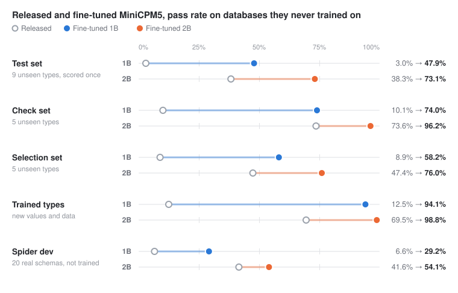

# Teaching MiniCPM5 1B and 2B to be SQL agents on a MacBook

I've been training MiniCPM5-1B, and then MiniCPM5-2B, to answer questions about a SQLite database by writing and running SQL. Everything runs locally on an M3 Pro with 36 GB of memory, using MLX, LoRA adapters and group-relative policy optimisation (GRPO). A small API model helps generate training questions and check them.

The short version: both models went through the same pipeline with the same data and time budget. On a test set of question types neither model trained on, written after every design decision and scored once, the 1B goes from 3.0% to 47.9% correct and the 2B from 38.3% to 73.1%. On the question types they did train on, measured on databases they had never seen, the 1B goes from 13% to 94% and the 2B from 70% to 99%. On Spider dev, 20 databases with schemas neither model trained on, the 1B goes from 6.6% to 29.2% and the 2B from 41.6% to 54.1%.

## The task

The model gets a question such as "Which customers have placed more than 10 orders? Return only their names." It has two tools:

- `run_sql` runs a read-only query and shows ten preview rows.
- `submit_sql` submits the final query and ends the episode.

The complete result of the submitted query is the answer. Prose doesn't count, and the preview limit doesn't matter for grading. A correct answer scores 1, a wrong one 0, and running out of turns or tokens scores -0.2.

## Grading that can't be gamed

Most of the early work went into the verifier, because a reward model that accepts wrong SQL teaches wrong SQL.

Each submission is run against four databases and has to match the reference query on all of them. Row order is ignored, but column order, duplicate rows, text and integer precision all count. Results over 10,000 rows return an error instead of being silently cut off, and queries that read the clock are rejected.

The four databases aren't random copies. One is deliberately adversarial: two different customers with the same name in every city, two same-name customers who are both top spenders, prices exactly on the thresholds the questions use, signups and orders outside the usual years, and cancelled orders large enough to change which category "wins" if you forget the status filter.

I tested it with 21 plausible wrong rewrites of the reference queries, things like `COUNT(DISTINCT name)` instead of `COUNT(*)`, `<=` instead of `<`, `GROUP BY name` instead of `GROUP BY id`, and a missing `status = 'shipped'`. Eleven of them passed the previous version of the verifier for at least one question. All 21 now fail for every parameter, while correct rewrites (`NOT EXISTS`, `LEFT JOIN ... IS NULL`, `BETWEEN`) still pass.

Regrading the archive from the first training run with the stricter checks rejected 376 of 2,266 answers that had been marked correct.

## Measuring generalisation

An early run looked great: evaluation went from 25% to 82.5%. Then I noticed that 23 of the 25 evaluation questions had appeared in training. That number measured memory, not ability.

So the evaluation now uses separate databases and three kinds of question:

| Split | What it tests |
| --- | --- |
| Reserved parameters | Trained question types with parameter values and data the model never trained on |
| Selection set | Five never-trained question types, used to pick checkpoints and stop early |
| Check set | Five other never-trained question types, scored only at the start and end of a run |

A separate ten-template test set was added after all the design decisions. It gets scored exactly once, on the released model and the final checkpoint, with the exclusion rule written down before any result existed.

## Results: both models through the same pipeline

<picture>
  <source media="(prefers-color-scheme: dark)" srcset="docs/results-dark.svg">
  
</picture>

`sqlrl/scripts/pipeline.sh` runs the same stages on any model: score the released model, distil from a fresh LoRA adapter on all layers, up to six hours of GRPO with early stopping, a second distillation pass, then one scoring of the test set. Both models used the same 787 solutions for the first distillation, the same 202 generated templates when RL started, the same 884 solutions for the second distillation, the same seed and the same six-hour RL budget. The 2B run took just under 11 hours and the 1B run eight and a half.

| | Released 1B | Fine-tuned 1B | Released 2B | Fine-tuned 2B |
| --- | --- | --- | --- | --- |
| Test set: 9 never-trained types, 33 questions | 3.0% (1-6%) | 47.9% (36-59%) | 38.3% (26-51%) | 73.1% (62-84%) |
| Check set: 5 never-trained types | 10.1% | 74.0% (60-85%) | 73.6% | 96.2% (91-100%) |
| Selection set: 5 never-trained types | 8.9% | 58.2% (41-76%) | 47.4% | 76.0% (62-89%) |
| Trained types, unseen parameters and data | 12.5% | 94.1% (88-100%) | 69.5% | 98.8% (98-100%) |
| All attempts | 7.4% | 62.2% | 52.5% | 83.1% |

The 1B gained more points on the test set (45 against 35) because it started near zero. The 2B removed more of its errors: 56% of its test-set misses against 46% for the 1B. The fine-tuned 1B passes the released 2B on every split except the check set, where the two are level.

The stages, from the in-run evaluations (8 attempts per held-out question):

| Stage | 1B selection | 1B check | 1B trained | 2B selection | 2B check | 2B trained |
| --- | --- | --- | --- | --- | --- | --- |
| Released | 8.6% | 11.8% | 18.8% | 52.0% | 75.0% | 64.1% |
| After distillation | 42.1% | 55.6% | 73.4% | 66.4% | 92.4% | 95.3% |
| After GRPO | 58.6% | 72.2% | 98.4% | 75.0% | 95.1% | 96.9% |
| After the second distillation | 59.2% | 76.4% | 90.6% | 75.7% | 96.5% | 95.3% |

Distillation did the most for both models. For the 1B it also taught the tool protocol: one pass took the selection set from 9% to 42%. RL mattered more for the 1B than for the 2B. The 1B is faster, so six hours covered 78 steps against 23, and it still failed often enough for most groups to carry signal; RL added 16 points on its selection set and 9 on the 2B's. The second distillation pass added a little on the never-trained sets for both, and the pipeline kept it in both runs. It cost the 1B some accuracy on trained types in the in-run evaluation (98% to 91%); the final scoring has them at 94%.

On the final scoring, 915 of the 1B's 1,472 attempts were correct and 1,223 of the 2B's; neither model ever stopped with a plain-text reply, and 30 and 37 attempts ran out of turns. The same types are hardest for both: the busiest month of a year (1B 0%, 2B 27%), the share of returned orders (0% and 5%) and lines per order by status (2% and 27%). Counting groups that pass a `HAVING` filter separates them most: the 1B reaches 21-35% and the 2B 69-77%.

The pipeline 1B also beat the development-run 1B on every never-trained split (test 47.9% against 44.7%, selection 58.2% against 50.0%), with less training. Per-template results are in `sqlrl/engineering/release-1b-pipeline-report.md` and `release-2b-report.md`.

## How the method was found: the development runs

Before the pipeline existed, the method was worked out on the 1B over several runs. These are the results of the last development checkpoint. Running the 1B through the pipeline later did better on every never-trained split, with less training.

All figures compare against the released `openbmb/MiniCPM5-1B` (bf16), not an earlier base checkpoint. Each question was attempted 16 times at temperature 1 with up to 384 tokens per turn. The brackets are 95% intervals from resampling questions.

| | Released 1B | Fine-tuned 1B |
| --- | --- | --- |
| Test set: 9 never-trained types, 33 questions | 3.6% (1-7%) | 44.7% (34-56%) |
| Check set: 5 never-trained types, 18 questions | 12.2% (2-23%) | 70.1% (56-83%) |
| Selection set: 5 never-trained types, 19 questions | 5.6% (2-11%) | 50.0% (32-69%) |
| Trained types, unseen parameters and data | 14.8% (5-28%) | 94.9% (91-98%) |
| All attempts | 8.0% | 58.8% |

One test template was excluded under the rule written before scoring, because a generated training template asks almost the same thing. Per-template results are in `sqlrl/engineering/release-1b-report.md`.

The released model mostly fails on protocol: 640 of its 1,472 attempts never submit SQL, and another 507 run out of turns. The fine-tuned model submits on almost every attempt, so its remaining errors are wrong SQL. The hardest held-out types are still hard: counting groups that pass a `HAVING` filter, returned-order ratios and month-of-year aggregation sit between 0% and 19%. Some others went from 0% to around 90%.

## What stopped it improving, and the fixes

The interesting part of this project has been the ways that more training made the model worse.

It ran out of things to learn. By step 60 of the first long run the model solved nearly every training question, so most updates carried no signal. Held-out scores peaked around step 160 and then drifted down. The fix was more question types: an API model now proposes new templates whenever the learning signal drops, and every proposal goes through the same data checks as the hand-written ones.

New types crowded out old ones. Adding over a hundred harder templates made the model forget simple questions within eight steps: accuracy on trained types fell from 100% to 58%. It started inventing tables like `books` and `categories`. A fixed share of each batch now replays templates it has already mastered.

A fresh optimiser made big, noisy jumps. Restarting Adam on an already-trained adapter moves every weight by roughly the learning rate on the first few steps. Resuming the saved optimiser state fixed that, and resumed runs now take their learning rate from the command line, not from the saved state.

Wrong SQL was being rewarded. In groups where nobody got the answer right, a wrong submission (0) scored above "ran out of turns" (-0.2), so wrong SQL got a positive update. In one run that happened up to 21 times per step, and a measure of policy noise rose tenfold in 12 steps. Wrong answers now never get positive credit.

Teacher examples from too far away caused damage. Injecting an API model's solutions to hard questions taught the student to bolt extra joins onto simple ones. Teacher solutions are now only used when the student already finds them reasonably likely (mean per-token negative log-likelihood under 1.0), and at half weight.

The policy swung between styles. With 16 questions per step from a varied pool, a few templates could dominate an update, and the selection score fell from 41% to 18% within four steps. Evaluating and saving an exponential moving average of the weights, together with a lower learning rate and a larger batch, smoothed that out.

With all of that in place, a 20-step validation run moved the check set from 40% to 59% with no loss on the trained types. A longer run with twice the batch size then plateaued at about 45% on the selection set after 30 steps.

## Distillation beat more RL

RL only learns from questions the model sometimes gets right, so question types it can't solve yet give it nothing. To get past the plateau, GLM-5.3-flash wrote solutions for every training type, four parameter choices each. Every solution was checked against all four databases, leaving 787 verified solutions across 212 types. They cost $0.12.

The model then trained on those solutions directly, mixed with 567 of its own correct answers so it wouldn't forget what it already knew. That's 86 updates at a low learning rate. The selection set went from 46% to 51% and the check set from 65% to 72%, with trained types unchanged at 97%. That was the last development checkpoint, and distilling before and after RL became the pipeline's recipe.

## Generating training data

The question bank has grown from 15 hand-written templates to 252 accepted generated ones; 202 of them existed when the two pipeline runs started, and their RL stages added the rest. 552 proposals were rejected. Claude Haiku 5.5 and GLM-5.3 propose templates, and a different model has to solve them without seeing the reference answer. In the latest generation round, Haiku also reviews each template for ambiguity. A template is rejected if its answer is the same on every database, if it depends on tie order, if a filter in it never changes the answer, or if its answers overlap a held-out question.

When the model keeps failing a template, the generator writes simpler stepping-stone templates that teach its parts. At 1B parameters, the model learns best from small steps it can almost manage.

Total API spend is about $2, most of it on template generation with review. All training and evaluation runs locally.

## Real schemas: Spider dev

Every split above uses the shop schema. To see whether the skills transfer, both models also ran Spider dev: 1,032 questions over 20 databases with schemas they never trained on, such as concerts, car makers, dog kennels and world countries. The agent loop is the same, with the Spider schema in the system prompt. Each question was attempted four times, and an answer counts when it matches the reference on the original database and on every one of Spider's test-suite variants.

| | Released 1B | Fine-tuned 1B | Released 2B | Fine-tuned 2B |
| --- | --- | --- | --- | --- |
| Test-suite pass@1 | 6.6% | 29.2% (27-32%) | 41.6% | 54.1% (52-57%) |
| Strict pass@1 | 6.5% | 28.3% | 38.7% | 50.5% |
| Solved in at least one of four attempts | 17.2% | 44.4% | 58.8% | 68.8% |

Both fine-tuned models are better than their released versions on all 20 databases. The 2B gains 12.5 points and the 1B 22.6. The 1B is still below the released 2B on 18 of the 20.

The 1B's weak point is recovering from errors on an unfamiliar schema. 1,491 of its 2,717 wrong answers fail to execute, 947 of them with "no such column". In 864 its last `run_sql` had just returned an error and it submitted anyway: 270 times the same failing query, 594 times an untested rewrite. In another 509 it submitted without running anything. A likely cause, which I haven't measured: the shop schema is small, so training rarely produced an execution error to learn from. For the 2B, 146 of 1,770 wrong answers fail to execute.

The shop training data includes templates modelled on Spider train questions and rewritten for the shop schema. Spider dev questions and schemas were never used for training. Per-database results are in `sqlrl/engineering/spider-dev-report.md`.

## Running the models locally

`sqlrl/scripts/export_gguf.sh` fuses a final adapter into its model and writes BF16, Q8_0 and Q4_K_M GGUF files: 1.15 GB and 0.69 GB for the 1B, 2.68 GB and 1.56 GB for the 2B. It sets no-think mode as the chat template default, because that is how the models were trained. At temperature 0 in llama.cpp, the 1B at Q8_0 gets 8 of the ten example prompts right and at Q4_K_M 6, so Q8_0 is the one to use.

`docs/lmstudio.md` explains how to test it in LM Studio, with a system prompt and ten example questions with their measured success rates. The model writes its own tool calls in the MiniCPM format, so you run each query against the evaluation database and paste the result back.

The evidence for every number above is in `sqlrl/engineering/verification.md`.
